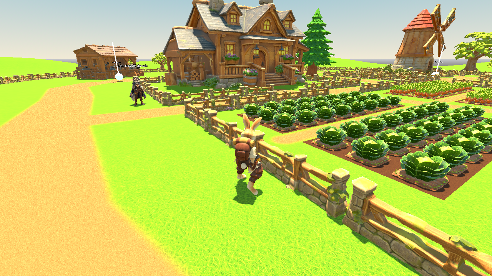
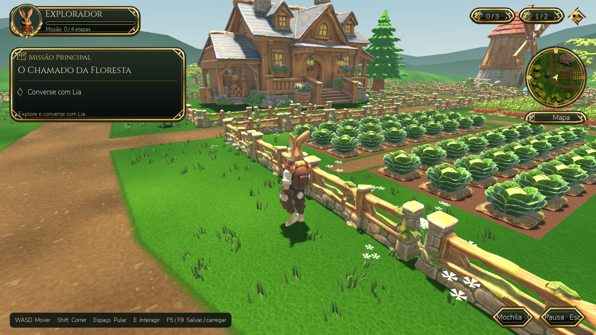
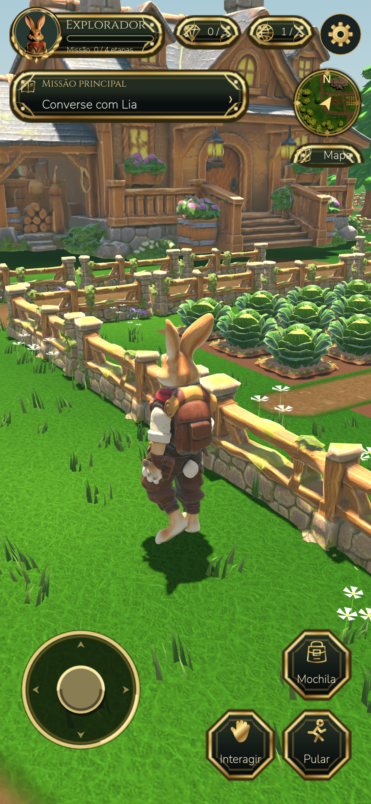

# Cenário e HUD de fantasia

Implementado em Godot 4.6.3 / Compatibility, preservando a fazenda, os modelos
fornecidos, colisões, cultivos, animações, missão e formato do salvamento.

## Cenário

- O shader do terreno mantém a textura Emerald Meadow e a máscara dos caminhos,
  com nova paleta, variação em escalas diferentes e detalhe de cascalho.
- Tufos de grama e flores são malhas pequenas geradas uma vez, agrupadas por
  setores em MultiMeshes. Máximo de 7.200 tufos e 540 conjuntos de flores;
  descarte por distância a 55/65 unidades. Não acrescentam colisão.
- As posições excluem os caminhos, a casa, as construções e as plantações
  protegidas. A passagem da missão permanece livre.
- Luz solar mais neutra, ambiente azulado, névoa comum, duas camadas de relevo
  distante, nuvens simples e 38 partículas junto à árvore ancestral.
- O ciclo de dia/noite dura cerca de 27,8 minutos. A cor do céu/ambiente é
  atualizada por limiar para evitar recalcular o céu a cada frame.

## HUD baseado na referência escolhida

Molduras e ícones SVG próprios, tipografia Cinzel/Nunito (licenças OFL junto dos
arquivos), retrato renderizado a partir do modelo do protagonista e moldura
circular com folhas douradas. Os controles de toque usam molduras chanfradas,
ícones e legendas, com joystick dourado e resposta multitoque preservada.

O minimapa compartilha o World3D existente, com câmera ortogonal e atualização
máxima de duas vezes por segundo enquanto a jornada está ativa. Mostra posição
e orientação da câmera do jogador e abre a vista aérea quando acionado. A imagem
é recortada por shader circular; não é uma ilustração estática.

A missão ocupa uma faixa de 58 pixels CSS, em vez do painel móvel anterior de
132 pixels. Ela mostra somente um resumo do objetivo atual; um toque abre o
título, objetivo e progresso completos em um menu. A faixa não repete o progresso
nem o título longo sobre o cenário.

A engrenagem tem oito dentes e fundo circular. Ela abre Configurações, com a
opção **Pausar jogo**. O botão de pausa foi retirado dos atalhos permanentes;
Mochila, Interagir e Pular permanecem acessíveis. O minimapa móvel passou de
90 para 72 pixels CSS, preservando a área de toque e a correção Retina.

A barra do retrato mostra **etapas reais da missão (0–4)**. Os indicadores mostram
**pedras coletadas (0–3)** e **regiões abertas (1–2)**. O retrato se chama
“Explorador”: Lia continua sendo a guardiã/NPC. Não foram inventados níveis, XP,
vida ou saldos de moedas/gemas. O aviso na mochila aparece quando há itens reais.

No navegador, a interface usa o tamanho CSS visível do canvas. A escala de
canvas do Godot mantém textos, ícones e áreas de toque com o mesmo tamanho em
DPR 1, 2 e 3, mesmo quando a resolução interna é 1170×2532 para uma janela CSS
de 390×844. A resolução do cenário 3D continua independente. O tamanho é
reconsultado após mudanças de orientação, tela cheia e barras do navegador.
Menu de pausa com rolagem para janelas baixas.

## Capturas reais

Geradas pelo Godot Compatibility com renderização Mesa/llvmpipe. Não são imagens
geradas por IA nem promessa de paridade com o conceito cinematográfico.

### Cenário anterior



### Primeira revisão do cenário e HUD em desktop (antes da faixa compacta)



### HUD atual no celular em pé, com faixa compacta (DPR 3)



## Validação

228 verificações de integração aprovadas, zero falhas. Incluem a missão até
abrir o portão, save/load, animações, acessos e colisões, joystick e segundo dedo,
vegetação fora dos acessos/cultivos e HUD/pausa em 1280×720, 390×844 e 844×390.
O minimapa compartilha o mundo real e os indicadores acompanham o estado real.
As verificações Retina cobrem retrato e paisagem em DPR 1, 2 e 3, incluindo
botões com pelo menos 64 pixels CSS de largura, toque em coordenadas físicas,
arrasto e liberação do joystick, e canvas temporariamente vazio na rotação.
Os testes também acionam a faixa da missão e a engrenagem com coordenadas
físicas em DPR 3, conferindo detalhes completos, pausa dentro de Configurações,
retorno ao jogo e ausência do botão de pausa entre os atalhos.

Exportações release Web e Windows geradas. O pacote Web é iniciado de fora do
projeto por `tests/export_smoke.gd`, verificando recursos, texturas e a missão.
O executável Windows não foi executado neste Linux. Não houve medição de FPS
em celular físico; MSAA, cobertura vegetal e minimapa acrescentam custo gráfico.

Para repetir as capturas em um desktop Linux com servidor gráfico:

```sh
DISPLAY=:99 godot --audio-driver Dummy --path . --script tools/capture_visuals.gd -- /tmp/eldervale-captures
```

Use `--hud-only --quick` após a pasta de saída para capturar só os três formatos
do HUD. Acrescente `--retina` para a captura em 390×844 CSS / DPR 3.
A captura mantém o HUD funcional e mostra o mesmo cenário da jornada.

Modelos de maior qualidade, vegetação mais elaborada, novas animações e os três
poderes continuam sendo trabalho futuro. Nenhum desses elementos é apresentado
como concluído nesta revisão.
